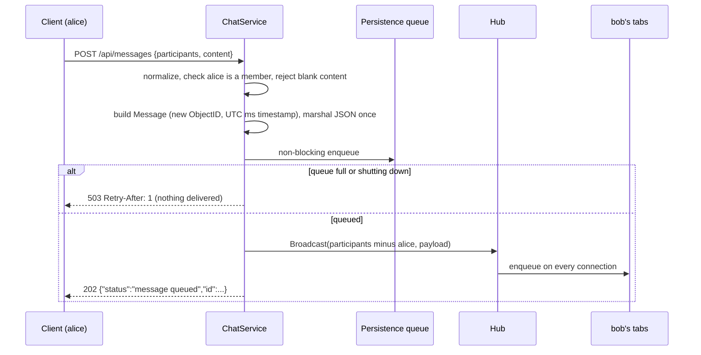

# Architecture

This document describes how the chat microservice is built and why. For endpoints, configuration and operations see the [README](README.md).

## Layers

```
cmd/server           wiring, signals, shutdown order
internal/server      routes and http.Server settings
internal/middleware  JWT authentication, per-user rate limiting
internal/httpapi     request decoding, response and error mapping
internal/service     business rules, persistence queue and workers
internal/ws          connection hub and per-connection writer
internal/repository  MongoDB access
pkg/models           Message and participant normalization
```

Dependencies point inward through small interfaces: handlers depend on a `Chat` (send, history) and a `Connections` (serve, counts) interface, and the service depends on a `Store` (save batch, history) and a `Broadcaster`. Handlers and the service are unit tested against fakes of these interfaces; the hub and the repository are tested against real WebSocket connections and a real MongoDB.

## Conversation model

A conversation has no ID of its own. It is the set of its participants' user IDs:

- `["alice", "bob"]` is a direct conversation, `["alice", "bob", "carol"]` a group, and `["alice"]` a note to self.
- `models.NormalizeParticipants` trims every ID, rejects empty ones, rejects more than 1000, then sorts and de-duplicates. `["bob", " alice", "bob"]` and `["alice", "bob"]` are the same conversation.
- Normalization runs before every write and every read, so the stored `participants` array is always canonical and a history lookup is an exact array match: `{participants: ["alice", "bob"]}`.
- Access control is membership in that set. There are no groups, roles or JWT claims beyond the user `id`.

The model makes creating a conversation free (send the first message) and keeps the token minimal. It also means the member list is immutable: adding someone to a group creates a new conversation with its own history.

### Message

```go
type Message struct {
    ID           bson.ObjectID `json:"id" bson:"_id"`
    Sender       string        `json:"sender" bson:"sender"`
    Content      string        `json:"content" bson:"content"`
    CreatedAt    time.Time     `json:"created_at" bson:"created_at"`
    Participants []string      `json:"participants" bson:"participants"`
}
```

The ID is a MongoDB ObjectID generated by the service, not by the database, and serialized as a 24-character hex string. `CreatedAt` is UTC, truncated to milliseconds so the delivered and stored values are identical.

## Request pipeline

| Route | Chain |
|-------|-------|
| `GET /health` | handler |
| `GET /ws` | auth → upgrade → hub |
| `POST /api/messages` | auth → rate limit → handler → service |
| `GET /api/messages/get` | auth → rate limit → handler → service → repository |
| `POST /api/connections` | handler → hub |

Authentication accepts only HMAC-signed tokens (`HS256`, `HS384`, `HS512`) with a non-blank `id` claim and stores the ID in the request context. The rate limiter keeps one token bucket per user ID, shared by both message routes. Request bodies are read through `http.MaxBytesReader` and must contain exactly one JSON document.

## Sending a message



The order is deliberate: the message is queued for persistence before it is delivered, so a recipient never sees a message the service has refused to store. The sender is taken from the token and removed from the recipient list, including the sender's other tabs; clients render their own message from the `202` response.

## Persistence

`ChatService` owns a buffered channel of 1024 messages and 4 worker goroutines.

1. A worker blocks until one message arrives, then drains whatever else is already queued, up to 256 messages, without waiting for more. Under light load a batch is a single message with no added latency; under heavy load batches grow and round trips shrink.
2. The batch is written with one unordered `InsertMany`.
3. On failure the batch is attempted up to `RETRY_ATTEMPTS` times in total, each attempt with a 5 second timeout and a linear backoff of 100 ms × attempt between attempts.
4. Retries are idempotent. IDs are assigned before the first attempt, so if an earlier attempt partially succeeded, the documents already stored come back as duplicate-key errors, and a bulk error made only of duplicates counts as success.
5. A batch that still fails after the last attempt is logged and dropped.

Backpressure comes from the bounded channel: when MongoDB stalls and the queue fills, `Send` fails with `ErrOverloaded` (`503`) instead of blocking request goroutines or growing memory.

Delivery and persistence are decoupled, so a history read issued right after a `202` may not include the message yet. A message can be lost after delivery only if every attempt fails, the shutdown budget runs out, or the process dies before its batch is written.

## History

`History` normalizes and authorizes like `Send`, then runs one query:

```
find({participants: <normalized>})
  .sort({created_at: -1, _id: -1})
  .skip(page * size)
  .limit(size)
```

At startup the repository creates the compound index `{participants: 1, created_at: -1, _id: -1}`, which matches both the equality filter and the newest-first sort order. `_id` breaks ties between messages created in the same millisecond. Pagination is offset based: `page` is limited to 10000 and `size` to 100, and new messages shift older pages. An empty conversation returns `[]`.

## WebSocket delivery

### Hub

The hub is a `map[userID]set[*Client]` behind a `sync.RWMutex`. A user can hold any number of connections (tabs, devices), and each one receives every message of every conversation the user is in, because the payload carries `participants` and the client routes it.

`Broadcast` runs on the sending request's goroutine under the read lock, so independent senders fan out in parallel and never contend with each other. It only enqueues; it never writes to a socket. Connections that reject the payload because they are over budget are collected and closed after the lock is released.

### Client

Each connection is a `Client` with:

- **A byte-bounded queue.** The budget is 4 MiB of queued payload. A payload that would push a non-empty queue over the budget makes the client a slow consumer and it is closed with `1008 slow consumer`. A single payload larger than the budget is still accepted into an empty queue. Bursts are absorbed without evicting healthy readers, while a stalled reader cannot pin unbounded memory.
- **An on-demand writer.** The goroutine that enqueues first claims the writer role and starts a `flush` goroutine; it writes the whole queued batch, swaps in a spare slice for the next batch, and exits when the queue is empty. Payloads are shared between recipients and marshaled once per message.
- **Timer-driven pings.** A `time.AfterFunc` timer queues a ping every 54 s instead of a dedicated ticker goroutine. The reader extends a 60 s read deadline on every pong, so a dead peer is dropped within about a minute.
- **A discard-only reader.** `readPump` reads frames only to process control frames and detect disconnects. Inbound data is never interpreted or relayed, and frames over 512 bytes close the connection with `1009`.
- **A single close path.** The first `close(frame)` wins: the writer sends that close frame, stops the timer and releases the socket. Close codes are `1000` on client close or I/O error, `1001` on shutdown and `1008` for slow consumers.

An idle connection therefore costs one parked reader goroutine plus its buffers. Read buffers are 512 bytes and write buffers are pooled.

The upgrader accepts any `Origin`, because the connection is authenticated by the `Authorization` header, which browsers do not attach to cross-site WebSocket handshakes. As a consequence, browser clients reach the service through a backend or proxy that adds the header.

## Shutdown

On `SIGINT` or `SIGTERM`, `main` runs these steps in order within a 15 second budget:

1. `http.Server.Shutdown`: stop accepting connections and finish in-flight requests.
2. `Hub.Shutdown`: mark the hub closed (new upgrades get a `1001` close), send `1001 server shutting down` to every client and wait for the close frames.
3. `ChatService.Close`: reject new sends with `503`, close the queue and wait for the workers to persist everything still queued.
4. Disconnect from MongoDB.

The end-to-end suite checks this: every message acknowledged with `202` before `SIGTERM` is in the database after a restart.

## Design decisions

| Decision | Reason | Cost |
|----------|--------|------|
| Participant set as conversation identity | No conversation bookkeeping, minimal JWT, authorization is a membership check | Membership changes create a new conversation |
| One WebSocket per tab for all conversations | Constant connections per user, simple clients | Every payload carries its participant list |
| Sender excluded from broadcast | No duplicates for optimistic UIs, less traffic | The sender's other tabs do not see the message live |
| Deliver before persisting | Send latency is independent of database latency | History is eventually consistent; exhausted retries lose a delivered message |
| Bounded queues with fast `503` | Memory and goroutines stay bounded under database stalls | Clients must retry |
| Receive-only WebSocket | Smaller attack surface; all writes go through the authenticated, rate-limited REST path | Two transports per client |

## Limits of the current design

- **Single instance.** The hub and the rate limiter live in process memory. All connections of a conversation's members must be on the same instance, and `/api/connections` only counts local connections. Running several replicas would need cross-instance fan-out (for example a pub/sub layer) and shared rate limiting, which are not implemented.
- **No replay.** Messages sent while a client is disconnected are not pushed on reconnect; clients reload them from history.
- **Rate limiter state is never evicted**, so it grows with the number of distinct users seen since startup.
- **Offset pagination** is simple but degrades on deep pages and shifts as new messages arrive; that is why `page` is capped.
