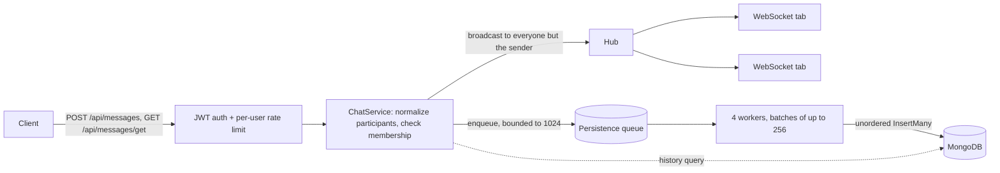

# Real-Time Chat Microservice

[](https://hub.docker.com/r/slincsilver/real-time-chat-microservice)
[](https://hub.docker.com/r/slincsilver/real-time-chat-microservice)
[](go.mod)
[](LICENSE)

A Go microservice that adds one-to-one and group chat to a product that already issues JWTs. A conversation is identified by the set of its participants, so there are no rooms or channels to create or manage. Messages are sent over a small REST API, delivered to every recipient over a single WebSocket per browser tab, and persisted to MongoDB in batches without making the sender wait on the database.

## Contents

- [Features](#features)
- [Quick start](#quick-start)
- [How it works](#how-it-works)
- [API reference](#api-reference)
- [Configuration](#configuration)
- [Security model](#security-model)
- [Image security and supply chain](#image-security-and-supply-chain)
- [Development and testing](#development-and-testing)
- [Performance](#performance)
- [Related services](#related-services)
- [License](#license)

## Features

- **Participant-based conversations**: `["alice", "bob"]` is a direct chat, `["alice", "bob", "carol"]` a group. IDs are trimmed, de-duplicated and sorted, so any order names the same conversation.
- **One WebSocket per tab, every conversation**: a connection receives messages from all conversations its user takes part in, and every open tab of a recipient gets each message.
- **Deliver first, persist in batches**: messages are queued, pushed to recipients at once and written to MongoDB by workers that insert whatever has queued up in one round trip. Retries are idempotent because message IDs are generated up front.
- **Explicit backpressure**: when persistence cannot keep up, sends fail fast with `503` and `Retry-After` instead of blocking, and nothing is delivered for a rejected message.
- **Paginated history**, newest first, served from a compound index that covers the sort.
- **Bounded per-connection memory**: each WebSocket has a 4 MiB outbound budget; a stalled reader is disconnected instead of slowing down everyone else.
- **Graceful shutdown**: on `SIGTERM` the server stops accepting requests, closes WebSockets with `1001` and persists every queued message before disconnecting from MongoDB.
- **Hardened defaults**: HMAC-only JWT verification, per-user rate limiting, body, participant and page limits, HTTP timeouts, and a `scratch` image that runs as non-root and is signed and attested.

## Quick start

The service needs a MongoDB instance and a `JWT_SECRET` shared with whatever issues your users' tokens. The examples use `mongo:7.0`: MongoDB 8.x and 9.x refuse to start on Linux kernels 6.19+ ([SERVER-121912](https://jira.mongodb.org/browse/SERVER-121912)), which includes current Docker Desktop VMs.

### Published image

The image is published on Docker Hub as [`slincsilver/real-time-chat-microservice`](https://hub.docker.com/r/slincsilver/real-time-chat-microservice). The current tag is `1.0.1`, also available as `latest`. It is multi-arch (`linux/amd64`, `linux/arm64`).

```bash
docker pull slincsilver/real-time-chat-microservice:1.0.1

docker network create chat
docker run -d --name mongodb --network chat mongo:7.0
docker run --rm --name chat-microservice --network chat -p 8080:8080 \
  --read-only --cap-drop=ALL --security-opt=no-new-privileges \
  -e JWT_SECRET=change-me \
  -e MONGO_URI=mongodb://mongodb:27017 \
  slincsilver/real-time-chat-microservice:1.0.1
```

```bash
curl http://localhost:8080/health
# {"status":"ok","time":"2026-10-21T13:30:45Z"}
```

The server exits at startup if `JWT_SECRET` is missing, any setting is invalid or MongoDB cannot be reached within 10 seconds.

### Docker Compose

[`docker-compose.yml`](docker-compose.yml) runs the published image next to MongoDB with persistent volumes (`mongodb_data`, `mongodb_config`), a read-only root filesystem, all capabilities dropped, `no-new-privileges` and memory, CPU and PID limits. `JWT_SECRET` is required. `PORT`, `MONGO_DB`, `MONGO_COLLECTION`, `RETRY_ATTEMPTS`, `RATE_LIMIT_RPS`, `RATE_LIMIT_BURST` and `MAX_BODY_BYTES` are passed through from the shell or a `.env` file next to the compose file, with the defaults from the [configuration table](#configuration).

```bash
export JWT_SECRET=change-me
docker compose pull
docker compose up -d
docker compose logs -f chat-api
```

`docker compose up --build` builds the image from the local sources instead. To inspect stored messages:

```bash
docker exec -it chat-mongodb mongosh chatdb --eval 'db.messages.find().sort({created_at: -1}).limit(5)'
```

### From source

Requires Go 1.27.3 or later.

```bash
docker run -d -p 127.0.0.1:27017:27017 --name mongodb mongo:7.0

export JWT_SECRET=change-me
go run ./cmd/server
```

`MONGO_URI` defaults to `mongodb://localhost:27017`. The server also loads a `.env` file from the working directory when one exists.

### Demo client

[`demo/`](demo) contains an interactive Node.js CLI (Node 18+) that mints a token for a user ID you type, then lets you open a WebSocket, send messages, read history, query connection counts and check health. It signs tokens with the hard-coded secret `your-jwt-secret`, so start the server with `JWT_SECRET=your-jwt-secret` when using it. `SERVER_HTTP` and `SERVER_WS` override the default `http://localhost:8080` and `ws://localhost:8080`. See [demo/README.md](demo/README.md) for the full menu and troubleshooting.

```bash
cd demo
npm install
npm start
```

Run it in two terminals: connect as `alice` (option 1) in one, and in the other send a message as `bob` (option 2) to the participants `alice, bob`. Alice's terminal prints:

```
[10:30:45] Channel [alice, bob]
  bob: Hi Alice!
```

## How it works



**Conversations.** Participant lists are normalized (trimmed, de-duplicated, sorted) and stored as the `participants` array of each message. History is an exact match on that array, sorted by `created_at` and then `_id`, both descending. At startup the service creates the index `{participants: 1, created_at: -1, _id: -1}`, which serves both the filter and the sort.

**Sending.** The sender always comes from the JWT, never from the request body, and must be one of the participants. The service builds the message (new ObjectID, UTC timestamp truncated to milliseconds), puts it on the persistence queue without blocking, then queues it on every connection of every recipient. If the queue is full the request fails with `503` before anything is delivered. The sender is excluded from the broadcast, including the sender's other tabs, so clients render their own messages from the `202` response. A message whose only participant is the sender (a note to self) is stored but not delivered.

**Persistence.** Each of the 4 workers takes one message from the queue, drains whatever else is already queued (up to 256 messages) and writes the batch with a single unordered `InsertMany`. A failed batch is attempted up to `RETRY_ATTEMPTS` times in total with linear backoff (100 ms × attempt, 5 s timeout per attempt). Because IDs are assigned before the first attempt, duplicate-key errors on a retry mean the document is already stored and count as success. A batch that still fails after the last attempt is logged and dropped.

**WebSockets.** The hub maps each user ID to its open connections. Broadcasts run on the sending request's goroutine under a read lock, so concurrent senders fan out in parallel. Each connection has a byte-bounded outbound queue; a writer goroutine exists only while there is something to write and pings are timer driven, so an idle connection costs one parked reader goroutine. Inbound frames are read and discarded: the socket is receive-only.

**Shutdown.** On `SIGINT` or `SIGTERM` the server stops accepting HTTP requests, closes every WebSocket with `1001`, closes the persistence queue and waits for the workers to write what is left, then disconnects from MongoDB, all within a 15 second budget.

**Scaling limits.** Connection state and rate limit counters live in process memory, so one instance must hold every connection of the users in a conversation. Running several replicas would require cross-instance fan-out (for example a pub/sub layer) and shared rate limiting, which this service does not implement.

[ARCHITECTURE.md](ARCHITECTURE.md) covers the send path, persistence workers, hub and writer model, shutdown order and design trade-offs in more depth.

## API reference

| Method | Path | Auth | Rate limited | Description |
|--------|------|------|:---:|-------------|
| `GET` | `/health` | No | No | Liveness check |
| `GET` | `/ws` | JWT | No | WebSocket upgrade; receives messages from all of the user's conversations |
| `POST` | `/api/messages` | JWT | Yes | Send a message to a conversation |
| `GET` | `/api/messages/get` | JWT | Yes | Read a conversation's history, newest first |
| `POST` | `/api/connections` | No | No | Count open WebSocket connections per user |

Authenticated routes expect `Authorization: Bearer <jwt>`; `/ws` also accepts `?token=<jwt>`. JSON responses carry `Content-Type: application/json`; error responses are short plain-text bodies (for example `forbidden: user must be part of participants`) that never include internal details. Other methods on a known path get `405`, unknown paths `404`.

### `GET /health`

```json
{"status": "ok", "time": "2026-10-21T13:30:45Z"}
```

### `POST /api/messages`

```bash
curl -X POST http://localhost:8080/api/messages \
  -H "Authorization: Bearer $TOKEN" \
  -H "Content-Type: application/json" \
  -d '{"participants": ["alice", "bob", "carol"], "content": "Hello everyone!"}'
```

The body must be exactly one JSON object; unknown fields (including `sender`) are ignored. `content` is stored and delivered verbatim but must not be blank.

`202 Accepted`:

```json
{"status": "message queued", "id": "6716a3f5c2b1e4d0a8f3b912"}
```

### `GET /api/messages/get`

| Query parameter | Default | Rules |
|-----------------|---------|-------|
| `participants` | required | Comma-separated user IDs; the caller must be one of them |
| `page` | `0` | 0-based; above `10000` is rejected with `400`; non-numeric or negative falls back to `0` |
| `size` | `50` | Capped at `100`; non-numeric or below `1` falls back to `50` |

```bash
curl "http://localhost:8080/api/messages/get?participants=alice,bob&page=0&size=20" \
  -H "Authorization: Bearer $TOKEN"
```

`200 OK` with an array (`[]` for an empty conversation):

```json
[
  {
    "id": "6716a3f5c2b1e4d0a8f3b912",
    "sender": "bob",
    "content": "Hi Alice!",
    "created_at": "2026-10-21T13:30:45.123Z",
    "participants": ["alice", "bob"]
  }
]
```

Pagination is offset based (`skip = page × size`), so messages arriving between requests shift older pages.

### `GET /ws`

The upgrade request must carry the JWT either as `Authorization: Bearer <jwt>` or as a `?token=<jwt>` query parameter. Browsers cannot set headers on a WebSocket handshake, so browser clients use the query parameter; native and server-side clients can send the header. If both are present, the header wins and the query parameter is ignored. The token is validated exactly the same way in both cases. `?token=` is accepted on `/ws` only: REST routes ignore it and still require the header.

URLs end up in proxy, load balancer and access logs, so a token passed in the query string can be recorded. Give WebSocket tokens a short `exp` (for example a minute, minted right before connecting) and avoid logging full request URLs at your own proxies.

```javascript
const ws = new WebSocket(`ws://localhost:8080/ws?token=${encodeURIComponent(token)}`);
```

Native and server-side clients can use the header instead:

```javascript
import WebSocket from 'ws';

const ws = new WebSocket('ws://localhost:8080/ws', {
  headers: { Authorization: `Bearer ${token}` },
});

ws.on('message', (data) => {
  const msg = JSON.parse(data);
  console.log(`[${msg.participants.join(', ')}] ${msg.sender}: ${msg.content}`);
});
```

Each text frame is one message in the same shape as a history entry. The server sends nothing else: no history replay on connect and no acknowledgements. After a reconnect, load missed messages from the history endpoint.

| Behaviour | Value |
|-----------|-------|
| Server ping interval | 54 s |
| Pong deadline (connection dropped without one) | 60 s |
| Write deadline per frame | 10 s |
| Maximum inbound frame (larger frames close with `1009`) | 512 bytes |
| Outbound queue budget per connection | 4 MiB |

| Close code | Reason |
|------------|--------|
| `1000` | Client closed, read error or write failure |
| `1001` | `server shutting down` |
| `1008` | `slow consumer`: the outbound queue exceeded 4 MiB; reconnect and reload history |

Frames sent by the client are discarded and never relayed; protocol violations such as unmasked frames close the connection with `1002`.

### `POST /api/connections`

Returns how many WebSocket connections each requested user currently has on this instance.

```bash
curl -X POST http://localhost:8080/api/connections \
  -H "Content-Type: application/json" \
  -d '{"users": ["alice", "bob", "carol"]}'
```

```json
{"alice": 2, "bob": 1, "carol": 0}
```

`users` must be a non-empty array of at most 1000 IDs.

### Status codes

| Status | When |
|--------|------|
| `200` | History, connection counts, health |
| `202` | Message accepted for delivery and persistence |
| `400` | Malformed or trailing JSON, missing or empty participant IDs, more than 1000 participants or users, blank content, missing `participants` query parameter, `page` above 10000, WebSocket route requested without an upgrade |
| `401` | Missing or malformed `Authorization` header (or `?token=` on `/ws`); forged, expired, not-yet-valid or non-HMAC token; token without an `id` claim |
| `403` | The authenticated user is not one of the participants (sending or reading) |
| `405` / `404` | Wrong method on a known path / unknown path |
| `413` | Request body larger than `MAX_BODY_BYTES` |
| `429` | Per-user rate limit exceeded |
| `431` | Request headers larger than 32 KiB |
| `500` | Unexpected error (for example MongoDB unavailable on a history read); details are logged, not returned |
| `503` | Persistence queue full or service shutting down; `Retry-After: 1`. Nothing was delivered |

## Configuration

All settings come from environment variables (or a `.env` file in the working directory).

| Variable | Default | Description |
|----------|---------|-------------|
| `JWT_SECRET` | none, required | HMAC secret used to verify user JWTs |
| `MONGO_URI` | `mongodb://localhost:27017` | MongoDB connection string; `mongodb+srv://` and TLS work because the image ships a CA bundle |
| `MONGO_DB` | `chatdb` | Database name |
| `MONGO_COLLECTION` | `messages` | Collection name |
| `PORT` | `8080` | HTTP listen port |
| `RETRY_ATTEMPTS` | `5` | Attempts per persistence batch; integer ≥ 1 |
| `RATE_LIMIT_RPS` | `5` | Sustained requests per second per user on `/api/messages` and `/api/messages/get` (shared budget); positive number |
| `RATE_LIMIT_BURST` | `10` | Burst size per user; integer ≥ 1 |
| `MAX_BODY_BYTES` | `65536` | Maximum request body; larger requests get `413`; integer ≥ 1 |
| `PPROF_ADDR` | unset (off) | Address for an optional `net/http/pprof` listener, e.g. `127.0.0.1:6060`. Never expose it publicly |

Invalid values stop the service at startup with every problem reported at once, for example `RETRY_ATTEMPTS must be >= 1, got 0`. Empty values fall back to the default.

## Security model

**Authentication.** Every route except `/health` and `/api/connections` requires `Authorization: Bearer <jwt>`; `/ws` alone also accepts the token as a `?token=` query parameter, validated identically (see [`GET /ws`](#get-ws) for the log-exposure caveat). Tokens are verified with `JWT_SECRET` and only `HS256`, `HS384` and `HS512` are accepted, which rules out `alg: none` and RSA/HMAC confusion. The `id` claim is the user ID and must be present and non-blank. `exp` and `nbf` are enforced when present but not required, so issue short-lived tokens.

```json
{"id": "alice", "iat": 1761053445, "exp": 1761139845}
```

**Authorization.** The only rule is membership: a user can send to and read a conversation only if their ID is in its participant list. The sender is taken from the token, so it cannot be spoofed through the body, and a WebSocket only ever receives conversations its user belongs to. Participant IDs are used as plain strings in an exact-match query, so MongoDB operators in input are inert.

**Limits.**

| Limit | Value |
|-------|-------|
| Request body | `MAX_BODY_BYTES` (64 KiB default) |
| Participants per message, users per connections query | 1000 |
| History page / page size | 10000 / 100 |
| Per-user rate limit | `RATE_LIMIT_RPS`, burst `RATE_LIMIT_BURST` |
| Request headers | 32 KiB |
| HTTP timeouts | read header 5 s, read 10 s, write 15 s, idle 120 s |
| Inbound WebSocket frame | 512 bytes |
| Outbound queue per WebSocket | 4 MiB, then closed with `1008` |

**Origins.** The WebSocket upgrade accepts any `Origin`. That is safe here because authentication relies on an explicit token, either the `Authorization` header or the `?token=` parameter, which a browser never attaches to a cross-site WebSocket handshake on its own, rather than on cookies.

**Deployment notes.**

- Terminate TLS (HTTPS/WSS) in front of the service; it listens on plain HTTP.
- `/api/connections` is unauthenticated by design and reveals whether users are online; keep it on an internal network if presence is sensitive.
- Keep `PPROF_ADDR` unset or bound to loopback.

## Image security and supply chain

- **Minimal image**: `scratch` base containing only the static binary and a CA bundle for TLS connections to MongoDB, running as UID `65532`. No shell, package manager or libc to exploit.
- **Pinned build**: the Go builder image is pinned by digest and module checksums are verified against `go.sum`; the build context is an allowlist of sources only.
- **Reproducible**: layer timestamps are set to the last commit time (`SOURCE_DATE_EPOCH`), so rebuilding a commit yields a bit-identical image digest.
- **Scanned before publishing**: `make docker-push` runs `make scan` first and refuses to publish if `govulncheck` finds a vulnerability reachable from the code or Docker Scout finds a fixable critical/high CVE in the image.
- **Attested**: every release carries an SBOM and SLSA provenance (max mode):
  ```shell
  docker buildx imagetools inspect slincsilver/real-time-chat-microservice:1.0.1 --format '{{json .SBOM}}'
  docker buildx imagetools inspect slincsilver/real-time-chat-microservice:1.0.1 --format '{{json .Provenance}}'
  ```
- **Signed**: releases are signed keyless with [Sigstore cosign](https://docs.sigstore.dev/); verify before deploying:
  ```shell
  cosign verify slincsilver/real-time-chat-microservice:1.0.1 \
    --certificate-identity=santiagolhgpro@gmail.com \
    --certificate-oidc-issuer=https://accounts.google.com
  ```
- **Run hardened**: `docker-compose.yml` runs the service with a read-only root filesystem, all Linux capabilities dropped, `no-new-privileges` and memory/CPU/PID limits. The equivalent `docker run` flags are `--read-only --cap-drop=ALL --security-opt=no-new-privileges`; `make e2e-image` runs the test suites against the container with these restrictions.

## Development and testing

```
cmd/server/          entrypoint, signal handling, graceful shutdown, PGO profile
internal/config/     environment parsing and validation
internal/server/     routes, HTTP server timeouts, pprof listener
internal/httpapi/    HTTP and WebSocket handlers, JSON decoding, error mapping
internal/middleware/ JWT authentication, per-user rate limiting
internal/service/    send/history rules, persistence queue, batching, retries
internal/ws/         connection hub and per-connection writer
internal/repository/ MongoDB persistence and history index
pkg/models/          message model and participant normalization
test/e2e/            end-to-end, security, concurrency and performance suites
demo/                Node.js CLI client
```

| Target | What it does |
|--------|--------------|
| `make test` | Unit tests with the race detector; repository tests use `MONGO_TEST_URI` or start a throwaway `mongo:7.0` container |
| `make e2e` | Full end-to-end run, including the performance suite |
| `make e2e-short` | End-to-end suites without the slow timeout tests and the performance suite |
| `make e2e-image` | Builds the image and runs the short suites against the hardened container |
| `make perf` | Performance suite only |
| `make bench` | Go micro benchmarks |
| `make pgo` | Refreshes `cmd/server/default.pgo` from the performance suite's CPU profiles |
| `make scan` | `govulncheck` plus Docker Scout (fixable critical/high CVEs) against the local image |
| `make docker-build` | Builds `slincsilver/real-time-chat-microservice:$(VERSION)` and `:latest` for the local platform |
| `make docker-push` | Runs `scan`, then pushes the multi-arch image with SBOM and provenance |
| `make sign` / `make verify` | Keyless cosign signature of the pushed index / signature verification |

- **Unit tests** cover every package: configuration validation, participant normalization (fuzzed), JWT forgery and algorithm confusion, per-user rate limiting, request decoding and error mapping, the route matrix, persistence backpressure, batching, retries and drain on shutdown, WebSocket fan-out, framing, ordering, ping/pong liveness and slow-consumer eviction, and the MongoDB repository against a real database.
- **End-to-end tests** (`test/e2e`, build tag `e2e`) start MongoDB in Docker, build the real binary with the race detector and coverage, boot it with throwaway secrets and its own database, and drive it with simulated users and browser tabs:
  - *functional*: direct and group messages, multi-tab delivery, participant set semantics, history order and pagination, verbatim content, notes to self, reconnects, graceful shutdown, every acknowledged message surviving a restart, startup validation;
  - *security*: forged/expired/algorithm-confused tokens and tokens without a user, sender spoofing, outsiders reading or writing conversations, Mongo operator injection, body/participant/page limits, rate limiting, method and route hardening, WebSocket protocol violations, slowloris, connection floods with goroutine-leak detection, no secrets or internals in error responses;
  - *concurrency*: concurrent group senders with exactly-once and per-sender ordering checks, isolated parallel conversations, tab churn, slow consumers, `SIGTERM` under load with exact durability checks, `503` backpressure while MongoDB is frozen with `docker pause`. Any data race, panic or unclean exit reported by the server fails the run.
- **Performance suite** profiles the live server through pprof and writes `test/e2e/reports/perf-<label>.md` with latency percentiles, throughput, memory and goroutines per connection, CPU/allocation/heap hotspots and the optimization opportunities they point to.

End-to-end environment variables: `E2E_IMAGE` (test a container image instead of a local build), `E2E_BINARY` (test a prebuilt binary), `E2E_MONGO_ADDR` (use an existing MongoDB instead of a container), `E2E_PERF_SCALE` (scale the performance scenarios), `E2E_PERF_LABEL` (report name, default `current`), `E2E_PERF_BASELINE` (add a comparison column from a previous report) and `E2E_REPORT_DIR` (report location).

## Performance

Release builds use profile-guided optimization: `cmd/server/default.pgo` merges the CPU profiles the performance suite captures from the live server, and `make pgo` refreshes it.

Driven by the performance suite's findings, measured on an Apple M3 Pro (11 cores) with the load generator and MongoDB on the same host:

| Metric | Before | After |
|--------|-------:|------:|
| Memory (RSS) per idle connection | 24.8 KiB | 13.0 KiB |
| Goroutines per idle connection | 2 | 1 |
| One-to-one messages per second (32 senders) | 7.0k | 45–50k |
| Send request latency p50 | 4.5 ms | 0.4 ms |
| Messages persisted per second | 6.4k | 44–52k |
| History reads per second (newest 50 of 6000) | 0.8k | 5.8–6.0k |
| History read latency p99 | 104 ms | 16–17 ms |
| Group fan-out to 999 members, delivery latency p50 / p99 | 3.8 / 9.6 ms | 3.9–4.6 / 9.8–10.9 ms |

The previous implementation inserted one document per round trip and made senders wait on it, which capped intake at the database's single-insert rate; persistence now writes batches and the history index covers the sort. At 7× the message rate, one-to-one delivery latency p99 rises from 1 ms to 4–5 ms. Remaining hotspots are kernel socket IO and the MongoDB driver allocating a decoder per inserted document to read back client-generated IDs.

## Related services

Part of a set of small, independently deployable Go services:

- **[Real-time UI update microservice](https://github.com/SantiagoLopezDeharo/real-time-ui-update-microservice)** ([`slincsilver/real-time-ui-update-microservice`](https://hub.docker.com/r/slincsilver/real-time-ui-update-microservice)): pushes backend events to browsers over WebSockets, with per-user `user:<id>` channels.
- **[Document module microservice](https://github.com/SantiagoLopezDeharo/document-module-microservice)** ([`slincsilver/document-module-microservice`](https://hub.docker.com/r/slincsilver/document-module-microservice)): converts data between JSON, YAML, TOML, XML, CSV, MsgPack and other formats, and renders PDF, DOCX and XLSX documents.

## License

[MIT](LICENSE)
